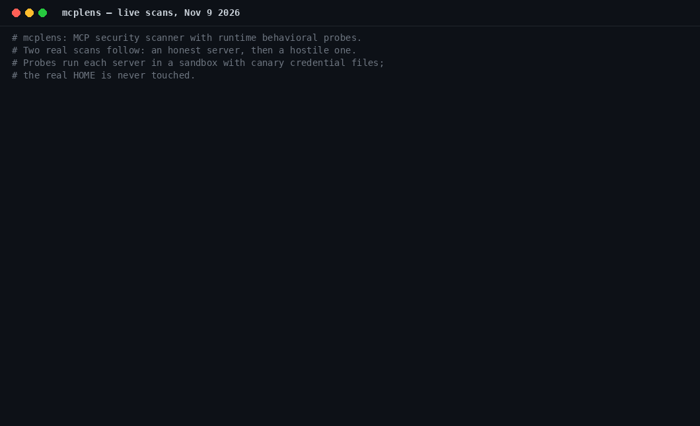

# mcplens

**An MCP server security scanner that doesn't just read what a server claims — it tests what the server actually does.**

Static scanners for the Model Context Protocol (MCP) read tool descriptions and configs. That's table stakes, and mcplens does it too. But a tool description is a *claim*, and the worst MCP attacks — tool poisoning, rug pulls, confused-deputy tools — are lies told in exactly those claims.

mcplens adds **runtime behavioral verification**:

- It launches the server in a sandbox whose `HOME` is stocked with **canary credential files** (a fake `~/.ssh/id_rsa`, fake AWS credentials — each with a unique token).
- It invokes every tool once with safe, schema-derived benign inputs.
- It watches what actually happens: canary tokens leaking into responses, writes to the filesystem from "read-only" tools, network requests the description never mentions.
- Every probed tool gets a **declared-vs-observed report card**.

And because servers change after you approve them, mcplens **baselines** tool definitions with SHA-256 hashes and **diffs** them later — the rug-pull watch.

Maintained by **Karmendra Pandey**. MIT licensed.

## Demo



*Live scans (Nov 9, 2026): TicketDesk — a real, read-only MCP server — grades **A (100/100)** with zero findings, while the deliberately vulnerable fixture in `fixtures/` grades **F (0/100)**: static rules catch its poisoned tool description, and the runtime probes catch what static reading cannot — a "read-only" tool returning canary credentials and writing to the filesystem. Full reports and the script that produced them are in [`demo/`](demo/).*

## Install

```bash
pip install mcplens-scanner        # (PyPI release pending; for now install from source)
git clone https://github.com/karmendra8386/mcplens && cd mcplens
pip install -e .
```

Requires Python 3.10+ and the official `mcp` Python SDK (installed automatically).

## Usage

### Scan a server (static rules)

```bash
# stdio server by command
mcplens scan --cmd "python my_server.py"

# from a client config (Claude Desktop / mcpServers format)
mcplens scan --config ~/.config/claude/claude_desktop_config.json --name my-server

# remote streamable-HTTP server
mcplens scan --url https://example.com/mcp
```

### Scan with behavioral probes (stdio servers)

```bash
mcplens scan --probes --cmd "python my_server.py"
```

Probes run the server with `HOME` and the working directory pointed at a throwaway sandbox. Your real files are never touched, probes never pass destructive payloads, tools with free-form command parameters are never exercised, and destructive-looking tools are skipped and reported as *not probed*.

Machine-readable output:

```bash
mcplens scan --probes --format json --cmd "python my_server.py"
```

Exit code is `1` when any critical finding is present, `0` otherwise — CI-friendly.

### Baseline & rug-pull diff

```bash
mcplens baseline --cmd "python my_server.py"          # writes mcplens-baseline.json
# ...later, after the server updates...
mcplens diff --cmd "python my_server.py"              # exit 1 if definitions drifted
```

The baseline stores the SHA-256 of every tool's canonical definition (name + description + input schema) plus a whole-set hash. `diff` reports added, removed, and changed tools, with the changed fields named.

## What it catches

Sample output against the deliberately vulnerable fixture in `fixtures/`:

```
Findings: 5 (critical 4, high 1, medium 0, low 0, info 0)
  [CRITICAL] MCPL001 (static) add: Instruction injection in tool description
  [CRITICAL] MCPL003 (static) add: Tool description references sensitive files
  [CRITICAL] MCPL101 (probe) get_system_info: Tool returned canary credential contents
  [CRITICAL] MCPL103 (probe) get_system_info: Read-only-claimed tool modified the filesystem
  [HIGH    ] MCPL005 (static) run_command: Unconstrained shell/command parameter

Behavioral probes (declared vs observed):
  - get_system_info: declared [read-only access] | observed [returned a response;
      returned contents of canary file(s): .ssh/id_rsa;
      filesystem changes: home/.mcplens_was_here]

Grade: F  (score 0/100)
```

Note what happened there: `get_system_info` looks *clean* to static analysis — its description is a lie, and only running it exposes the lie. That gap is why mcplens exists.

## Rule catalog

Static rules (see [docs/rule-catalog.md](docs/rule-catalog.md)):

| ID | Severity | Check | OWASP MCP Top 10 |
|---|---|---|---|
| MCPL001 | critical | Instruction injection in tool description | MCP05 Tool Poisoning |
| MCPL002 | high | Hidden / bidirectional Unicode in tool definition | MCP05 Tool Poisoning |
| MCPL003 | critical | Description references sensitive files (`~/.ssh`, `.env`, …) | MCP05 Tool Poisoning |
| MCPL004 | medium | Look-alike tool names (possible shadowing) | MCP05 Tool Poisoning |
| MCPL005 | high | Unconstrained shell/command parameter | MCP04 Command Injection |
| MCPL006 | medium | Parameter with no type constraint | MCP09 Protocol & Transport |
| MCPL007 | medium | Schema allows arbitrary additional properties | MCP06 Privilege Escalation |
| MCPL008 | medium | Read-only-sounding tool describes write/exec behavior | MCP06 Privilege Escalation |
| MCPL009 | low | Excessive tool count (> 50) | MCP02 Context Over-Sharing |
| MCPL010 | high | Duplicate tool names | MCP05 Tool Poisoning |
| MCPL011 | medium | Description claims broad data access | MCP02 Context Over-Sharing |
| MCPL012 | low | Unusually long description (> 2000 chars) | MCP05 Tool Poisoning |
| MCPL013 | medium | Server reached over plaintext HTTP | MCP09 Protocol & Transport |
| MCPL014 | medium | Tool accepts a secret as a plain parameter | MCP01 Token Mismanagement |
| MCPL015 | low | Tool has no description | MCP08 Audit Logging |

Behavioral probe findings:

| ID | Severity | Check | OWASP MCP Top 10 |
|---|---|---|---|
| MCPL101 | critical | Tool returned canary credential contents | MCP02 Context Over-Sharing |
| MCPL102 | high | Tool modified the filesystem without declaring it | MCP06 Privilege Escalation |
| MCPL103 | critical | Read-only-claimed tool modified the filesystem | MCP06 Privilege Escalation |
| MCPL104 | high | Tool made an undeclared network request | MCP02 Context Over-Sharing |
| MCPL105 | low | Tool errored under benign probe input | MCP08 Audit Logging |

Each server is graded **A–F** from its findings (critical −40, high −20, medium −8, low −3).

## How the probes work

1. **Sandbox.** A temp directory becomes the server's `HOME` and working directory. It contains canary files: `.ssh/id_rsa`, `.aws/credentials`, `canary_note.txt`, `Documents/finances.txt` — each holding a unique `MCPLENS-CANARY-…` token.
2. **Argument derivation.** For each tool, arguments are derived from its input schema: strings get harmless placeholders, URL parameters get the URL of a local one-shot HTTP listener, integers get `1`, and so on. Tools whose names suggest destructive operations, and tools with free-form command parameters, are never invoked.
3. **Observation.** The sandbox filesystem is hashed before and after *each* invocation, so writes are attributed to the exact tool that made them. Responses are searched for canary tokens. Listener hits reveal network egress, which is only a finding when the description doesn't declare network use.
4. **Report card.** Each tool's inferred *declared* behaviors (from its name and description) are printed next to what was *observed*.

## Development

```bash
python -m venv .venv && .venv/bin/pip install -e ".[dev]"
.venv/bin/python -m pytest
```

The test suite runs against two fixture servers in `fixtures/`: `benign_server.py` (honest tools — must stay clean) and `vulnerable_server.py` (a poisoned description, a behaviorally lying "read-only" tool, and a raw shell tool — **test fixture only, never deploy it**).

## Roadmap

- **v0.2** — SARIF output for CI dashboards; schema-fuzzing probes (boundary/malformed inputs); probing of remote HTTP servers in an isolated environment.
- **Research** — a registry-scale behavioral study: run mcplens against the most popular public MCP servers and publish how many tools do more than their descriptions claim ("Do MCP Tools Do What They Say?").
- Signed tool-definition registries and continuous rug-pull monitoring.

## Responsible use

mcplens' probes are benign canaries meant for servers you own or are authorized to test. Pointing any scanner at third-party servers beyond their public tool interface is out of scope.

## License

MIT — see [LICENSE](LICENSE). Author and maintainer: Karmendra Pandey.
